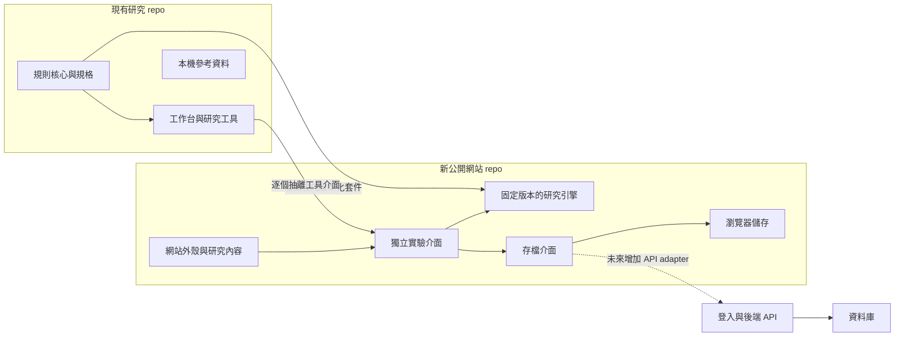

# 個人遊戲機制研究網站：架構與轉移規劃

## 建議決策

建立獨立 repo，建議 repo 名為 `game-mechanics-lab-site`，網站品牌為「遊戲機制研究室」（英文 `game-mechanics-lab`，原名 `gacha-game-tool`）。現有 `gacha-game-tool` 是研究與開發工作台，新 repo 是面向台灣手遊愛好者與遊戲開發者的個人網站。採 React + TypeScript + Vite，延續現有 UI 技術，減少移植成本。首階段靜態部署、無登入、無後端資料庫；需要的使用者設定與進度先儲存在瀏覽器並支援 JSON 匯入匯出。

這次做的是首頁與網站結構原型，沒有啟用遊玩存檔。`src/domain/contracts.ts` 只定義未來的存檔邊界，尚無 storage 或 API adapter。

## 網站導覽

| 頁面 | 主要內容 | 首次公開的最低內容 |
| --- | --- | --- |
| 首頁 `/` | 研究目的、關注方向、精選實驗與筆記入口 | 一眼看懂你在做什麼，以及可以先試什麼 |
| 工具遊樂場 `/lab` | 工具清單、狀態、分類 | 每個工具顯示可用／實驗中／準備中；未完成工具不提供假入口 |
| 工具 `/lab/:id` | 參數、試玩、結果與解釋 | 預設範例、重設、規則版本、適用範圍；加入存檔後提供匯入匯出 |
| 開發筆記 `/research` | 研究發現、開發紀錄與文章 | 問題、觀察、來源、版本、模型、驗證、限制 |
| 關於我與計畫 `/about` | 個人背景、計畫動機與交流入口 | 你是誰、為何開發、GitHub 和選定的聯絡方式 |
| 資料說明 `/privacy` | 存檔位置、資料用途與刪除方式 | 是否會上傳、如何保管存檔、模型限制 |

後續可加 `/changelog` 開發紀錄，適合持續演進的工具網站。先不加登入、留言板、排行榜、訂閱或完整後台。個人頁面不必一次填滿：研究動機、擅長方向、代表作品、聯絡入口已足夠。

以上為目標 URL。原型使用 `#/lab` 的 hash 導覽，支援各類靜態主機直接重整；文章 SEO 與獨立分享預覽尚未實作。筆記變多時再加入靜態預渲染，把文章生成實際 HTML URL，避免為了內容頁提前導入常駐伺服器。

## 系統邊界



本機參考資料不自動流入公開網站。核心只計算，不碰網頁、存檔與 API；網站負責導覽、文字、互動與資料生命週期。現有 core 的純 TypeScript 約束應保留。

## 新 repo 的成長結構

```text
game-mechanics-lab-site/
├─ src/
│  ├─ main.tsx                 # 現有原型入口；之後可拆成 app/、pages/
│  ├─ styles.css              # 網站外殼樣式
│  ├─ content/
│  │  ├─ experiments.ts       # 實驗清單、狀態、入口與版本
│  │  └─ research/            # 未來：Markdown 研究文章與來源 metadata
│  ├─ features/
│  │  ├─ crit-preview/        # 現有簡化互動示範
│  │  ├─ damage/              # 未來：正式傷害工具
│  │  ├─ action-order/        # 未來：行動順序工具
│  │  └─ gacha/               # 未來：抽卡完成後再移植
│  ├─ domain/contracts.ts     # 實驗登錄與存檔格式／介面
│  └─ infrastructure/         # 未來：local storage、IndexedDB、HTTP adapters
├─ public/                    # 原創或確認可發佈的公開資產
├─ vendor/                    # 未來：初期版本化 engine .tgz
├─ package.json
├─ package-lock.json
├─ README.md
└─ ARCHITECTURE.md
```

標示「未來」的目錄不需先建立空框架。新增一個實驗時才新增功能資料夾，並登錄到清單。每個工具能獨立載入；重型正式模擬器採動態 import，運算量大時再放到 Web Worker，保持首頁輕量。

## 如何從目前 repo 搬成果

### 1. 核心先維持單一來源

`packages/core` 已是無 DOM 的 TypeScript 規則核心；但目前 `package.json` 的入口直接指向 `src/index.ts`，標記 private，console 也透過 Vite alias 直接讀原始碼。它還不是可直接正式發佈的 npm 套件。

建議先讓現有 repo 的 core 產出 ESM 與型別宣告，設定 `exports`、`types`、`files` 白名單，保留 pure function 設計。先檢查 public exports 所引用的程式及預設資料，再用 `npm pack` 產生含版本的 `.tgz`，例如 `ggt-core-0.3.1.tgz`。

初期把這份 tarball 放入新 repo 的 `vendor/`，以 `file:vendor/ggt-core-0.3.1.tgz` 依賴並提交 lockfile。這種固定檔案可獨立建置，不需公開整個研究 repo、不依賴隔壁資料夾，也不需要私有 registry 憑證。套件檔案不是人工修改的核心副本：每次更新從原 repo 測試與打包，網站固定版本，來源 commit 記錄在版本文件。

原型尚未接入這個依賴。不要直接使用 `file:../gacha-game-tool/packages/core` 作為公開部署方案，也不要長期在兩個 repo 各維護一套修改過的核心。

需要更頻繁發版時，再把 **經確認可公開的核心** 獨立成第三個 engine repo 或公開 npm package。私有研究 repo 與公開網站都依賴它；公開 repo 不保留私有來源碼。此步可晚一點做，現在不需要為兩個 repo 管理三套發佈流程。

### 2. 先搬一個小工具，辨識共用相依

第一個候選是 `DamageBreakdown`，其次是 `ActionOrder`。目前這些元件不只是依賴 core，也引用 `ui.tsx`、`tools/common.tsx`、編輯元件、CSS 與 `useProject` 的 Updater。直接複製檔案不會是完整可移植功能。

移植步驟：

1. 選定小範圍公開行為：例如固定原創情境、可改攻擊／暴擊率、顯示分項結果。
2. 把工具與其必要共用元件放入 `features/damage/`，列出相依清單；不帶入整個 App、主控台導覽與全部編輯器。
3. 初次移植可用 adapter 暫時提供原本 `Project` 與 Updater 形狀，減少改寫。同時將初始化與存檔從計算元件抽離。
4. 穩定後收斂為工具專屬設定與 props，避免所有實驗都必須載入整份 Project。共用表單元件再提升到網站 shared UI。
5. core 只透過公開 API 使用；避免跨 repo 讀取 `src/`。建立最少必要原創 preset，標示 engine 與 rule 版本。
6. 重跑原核心的既有驗證與移植工具的關鍵結果，確認相同 seed 與設定得到相同結果，再公開入口。

`packages/console/src/demo` 的 game state、link、exportDemo 彼此相依較多，適合等小工具移植穩定後再做，不建議第一步整個搬。抽卡保持目前開發流程，完成後依同樣界面拆移；本次不改它。

### 3. 公開資料採白名單

此 repo 的 `data/reference/hsr`、研究快照與 `scripts/build-hsr-pack.mjs` 是本機研究流程；`docs/reference-pack.md` 已說明這類資料不隨工具發佈。新網站不自動複製它們。

公開 preset 優先使用原創角色、圖像、關卡與數值；若使用特定遊戲資料，逐份確認來源、版本與可公開範圍，並記錄在文章或 preset metadata。核心 tarball 的 `files` 白名單與內部引用要一起檢查，避免某個預設資料透過 import 被打包。不要直接公開現有 repo 的歷史來建立新網站。

## 存檔：先本機，但提前留好邊界

所有實驗元件都向 `SaveRepository` 存取，不直接呼叫 localStorage 或資料庫。接口使用 Promise，讓未來 HTTP 的非同步行為不必從 UI 開始重寫。

`SaveEnvelope` 至少包含 schemaVersion、experimentId、engineVersion、ruleVersion、seed、updatedAt、payload。每個實驗保留獨立 slot，瀏覽器 key 應使用 `game-mechanics-lab-site:<experimentId>:<slotId>`，避免與工作台現有 `ggt.project` 混用。

第一階段：少量設定用 localStorage，較大遊玩紀錄用 IndexedDB。只保存需要恢復的狀態，不保存無限增加的完整逐步歷史。大批量模擬結果預設只保留摘要，提供匯出。存檔必須在讀取與匯入時驗證格式、限制大小、處理版本遷移與儲存失敗；無法儲存時仍讓工具可用並提供匯出。

瀏覽器存檔會受網站 origin 限制，從 localhost 搬到正式網域、改網域或換裝置都不能直接讀取舊存檔。JSON 匯出／匯入是早期必要的可攜途徑；清除網站資料也會清除本機進度。

## 何時需要後端資料庫

| 需求 | 是否需要後端 |
| --- | --- |
| 記住本機參數、繼續本機進度 | 不需要；瀏覽器存檔＋匯出即可 |
| 把設定檔傳給朋友 | 不需要；先分享 JSON 檔案 |
| 跨裝置同步、登入後保存進度 | 需要登入、API 與資料庫 |
| 分享短網址且可遠端載入設定 | 通常需要後端儲存，或先用大小受限的 URL 編碼 |
| 匿名研究資料收集 | 需要接收與儲存服務，以及明確的選擇方式 |
| 留言、排行榜、社群內容 | 需要後端與防濫用設計；非第一階段 |

未來可先選受管理的 Postgres／身份服務，或其他提供 HTTP API 的資料服務；服務選型留到實際需求出現。資料表先分 `profiles`、`experiment_saves`、可選 `research_runs`，研究收集不能與個人存檔預設混在一起。

新增 HTTP SaveRepository 可以維持工具本體接口，但**不是只換 adapter 就全部完成**。仍需處理登入、每人只能讀取自己的存檔、API 驗證、資料庫 schema migration、多裝置衝突、離線與同步錯誤，以及更新資料說明。不要將資料庫管理密鑰放到前端；前端部署仍可維持靜態，經 API 存取後端。

## 公開節奏

1. 本次：架構、首頁原型、導覽、狀態清楚的試玩清單。
2. 首次公開：獨立 repo、基本個人介紹、一個驗證後的正式小工具、JSON 匯入匯出、靜態部署。
3. 持續更新：研究文章、開發紀錄、更多獨立工具、Web Worker 與文章預渲染。
4. 有實際需求才新增：登入、跨裝置存檔或自願參與的資料收集。

首階段驗收：新 repo 可從乾淨環境 `npm ci` 與 `npm run build`；首頁不載入所有模擬器；未完成工具不假裝可用；搬移後結果能與來源工具對照；沒有本機參考快照進入公開產物。

## 參考

- [Vite 靜態部署與 GitHub Pages 路徑](https://vite.dev/guide/static-deploy.html)
- [npm package.json 與本機套件依賴](https://docs.npmjs.com/cli/configuring-npm/package-json/)
- [MDN：瀏覽器儲存配額與資料清除](https://developer.mozilla.org/en-US/docs/Web/API/Storage_API/Storage_quotas_and_eviction_criteria)
- [MDN：IndexedDB 與同源限制](https://developer.mozilla.org/en-US/docs/Web/API/IndexedDB_API)
